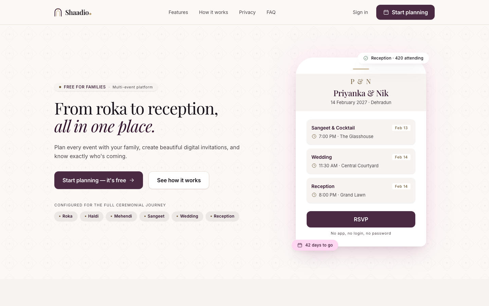
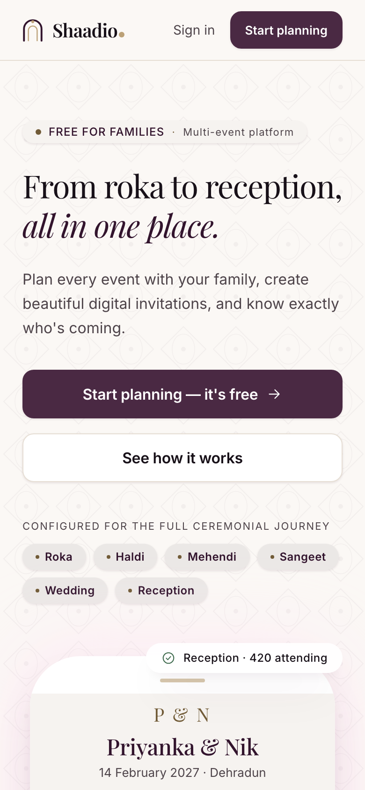

# Shaadio

Wedding-planning web app for Indian weddings: a shared workspace for the family, plus
account-free invitation, RSVP and photo pages for guests. Live at **[shaadio.in](https://shaadio.in)**.

<p align="center">
  
  &nbsp;
  
</p>

> **Status (17 Oct 2026): paused.** Milestone 1 (guest loop) is live except password reset and
> CSV import; Milestone 2 photos are complete. What is done, what is left and how to pick it up
> again are in [STATUS.md](STATUS.md).

## What it does

**For the family (signed in, one shared wedding workspace)**

- Create the wedding; invite family members as Admins or Managers.
- Events (roka to reception) with dates, times, venues, dress codes and map links.
- Guest list with sides, households, per-event invitations, filters and RSVP tracking.
- A private invitation link per guest: share on WhatsApp, or send by email singly or in bulk
  (queued, within a daily email quota).
- An unlisted wedding website (`/w/<slug>`): cover photo, all events, a welcome message and up to
  12 featured photos. Publish and unpublish at any time.
- A private photo gallery: upload from phone or computer, albums per ceremony, feature photos for
  the website, download, delete. Storage meter (2,000 photos per wedding).
- Share the gallery with guests by link or printable QR card; switch guest viewing and uploads on
  or off.

**For guests (no account, no app)**

- `/invite/<token>`: their own invitation with only the events they are invited to; RSVP with a
  headcount, until the RSVP deadline.
- `/gallery/<token>`: add photos (optional name and ceremony) and see everyone's photos, while the
  family allows it. 150 photos per phone per day.

Photos are resized in the browser (2560 px plus a thumbnail) and uploaded straight to Cloudflare
R2; the server verifies the bytes before publishing. Photos are deleted 12 months after the
wedding date.

## Stack

Next.js 16 (App Router) + TypeScript, deployed on Vercel · MongoDB Atlas + Mongoose · Zod ·
Cloudflare R2 (S3 API) for photos · Resend for email · Vercel Cron · Tailwind CSS v4 · next-intl ·
Vitest + mongodb-memory-server · Playwright.

The product and design docs are in [docs/](docs/): start with the [PRD](docs/PRD.md), then
[SYSTEM_DESIGN](docs/SYSTEM_DESIGN.md), [DATABASE_DESIGN](docs/DATABASE_DESIGN.md) and
[API_DESIGN](docs/API_DESIGN.md). Every slice's decisions are in
[IMPLEMENTATION_NOTES](docs/IMPLEMENTATION_NOTES.md). Rules for working in this repo are in
[CLAUDE.md](CLAUDE.md).

## Getting started

Requirements: Node 22.12+ (CI uses the version in `.nvmrc`) and corepack.

```sh
corepack enable            # provides the pnpm version pinned in package.json
pnpm install
cp .env.example .env.local # then fill in the values (see below)
pnpm db:migrate            # creates the indexes in your database
pnpm dev                   # http://localhost:3000, health check at /api/health
```

`MONGODB_URI` must point at a replica set, because transactions need one. An Atlas cluster
works, and so does a local single-node replica set.

### Environment

| Variable                                                                                        | Needed for                                                                                                        |
| ----------------------------------------------------------------------------------------------- | ----------------------------------------------------------------------------------------------------------------- |
| `MONGODB_URI`, `APP_ORIGIN`                                                                     | Always. The URI must name the database                                                                            |
| `SESSION_SECRET`                                                                                | Sign-in, tokens, signed upload tickets (32+ characters)                                                           |
| `R2_ACCOUNT_ID`, `R2_ACCESS_KEY_ID`, `R2_SECRET_ACCESS_KEY`, `R2_BUCKET_NAME`, `MEDIA_BASE_URL` | Photos and covers. All five or none; without them photo features are off. Setup: IMPLEMENTATION_NOTES, 2026-10-15 |
| `RESEND_API_KEY`, `EMAIL_FROM`                                                                  | Email. Without them, invitations are shared by link only                                                          |
| `CRON_SECRET`                                                                                   | The daily jobs in `vercel.json` (32+ characters)                                                                  |

Generate secrets yourself (`openssl rand -base64 32`) and keep them out of chats and commits.

## Scripts

| Command                        | What it does                                                                                                                 |
| ------------------------------ | ---------------------------------------------------------------------------------------------------------------------------- |
| `pnpm dev` / `build` / `start` | Next.js dev server, production build, production server                                                                      |
| `pnpm lint`                    | ESLint, including the architecture and tenant-isolation rules                                                                |
| `pnpm format` / `format:check` | Prettier                                                                                                                     |
| `pnpm typecheck`               | Generates route types, then runs `tsc`                                                                                       |
| `pnpm test`                    | Unit and integration tests (integration uses an in-memory MongoDB replica set)                                               |
| `pnpm test:unit` / `test:int`  | Runs one of the two projects                                                                                                 |
| `pnpm e2e`                     | Playwright on mobile and desktop profiles. Needs `MONGODB_URI` and Chromium (`pnpm exec playwright install chromium`)        |
| `pnpm db:migrate`              | Applies pending migrations to the database in `.env.local`. For production, prefix `MONGODB_URI=…` and add `-- --production` |
| `pnpm r2:check`                | Checks an R2 bucket end to end: signed upload, CORS, public read, delete                                                     |

## Deploying

Vercel builds `main`. After a deploy that adds a migration, run `pnpm db:migrate` against
production. Three daily cron jobs call `/api/internal/jobs/*` (email queue, upload cleanup, photo
retention) with `Authorization: Bearer $CRON_SECRET`.

## Layout

```
src/app          routing only: pages, layouts, thin route handlers
src/modules      one folder per domain (business logic), see src/modules/README.md
src/server       shared infrastructure: db (tenant guard, unscoped access), http, env, adapters
src/lib          pure utilities used by both client and server
src/components   UI primitives, app shell, photo upload pipeline
src/styles       design tokens and themes
messages         translation files
migrations       forward-only database migrations
scripts          migrate and r2:check
tests            test setup, lint-rule tests, security suites, e2e
docs             PRD, design docs, implementation notes, screenshots
```
